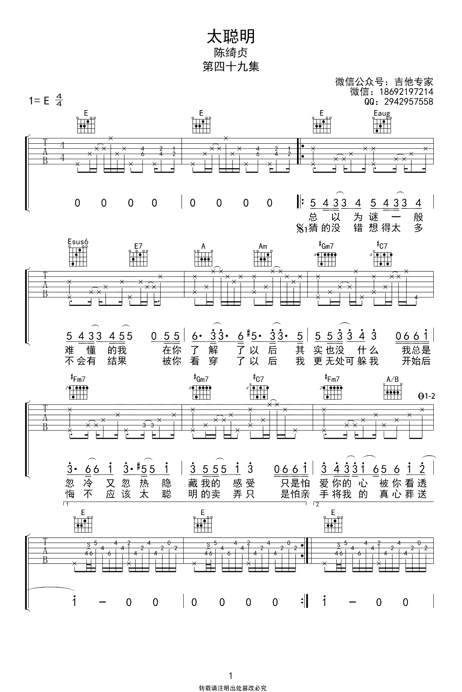
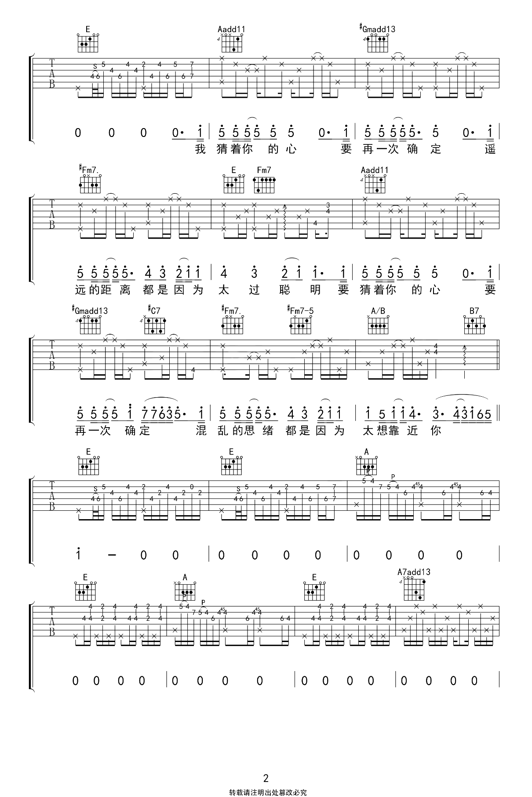
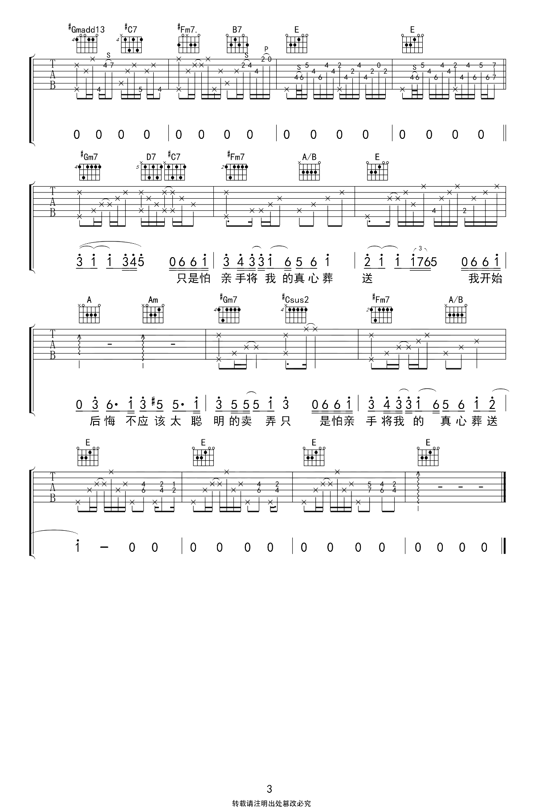

# 太聪明

> 我和他去了酒吧，台上的人说接下来要唱一首陈绮贞的歌，我猜是我唯一知道的一首《旅行的意义》，他猜是《太聪明》，被他猜中了。台上的人开始唱，我开始静静地听，我被歌词深深地吸引了，一字一句都是我。后来我们分开，他很洒脱，我很难过。到现在每一次听到这首歌，我都想起曾经的那个懦弱胆小又被迫强装镇定的自己，我想回去，抱抱自己说：“你很棒，你不需要得到谁的认可。”

> [www.jitabang.com](https://www.jitabang.com/jitapu/8005.html)

